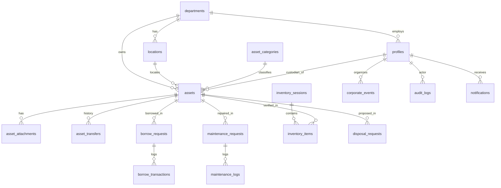

# ระบบบริหารจัดการครุภัณฑ์สำนักงานหน่วยงานราชการ (Government Asset Management System)

ระบบสารสนเทศเพื่อการบริหารจัดการครุภัณฑ์สำนักงานสำหรับหน่วยงานราชการไทย พัฒนาด้วย **React + TypeScript + Vite + Tailwind CSS** และเชื่อมต่อฐานข้อมูลจริงผ่าน **Supabase (PostgreSQL, Auth, Row Level Security, Storage, Realtime)**

---

## 1. คุณสมบัติหลักของระบบ

1. **ระบบเข้าสู่ระบบและสิทธิ์ผู้ใช้งาน 3 ระดับ (`admin`, `asset_officer`, `requester`)**:
   - ใช้ Supabase Auth และบังคับใช้สิทธิ์ในระดับฐานข้อมูลด้วย **Row Level Security (RLS)** บนทุกตาราง
   - ป้องกันผู้ใช้ทั่วไปยกระดับสิทธิ์ (`role`) ของตนเองด้วย Database Trigger (`prevent_role_escalation`)
2. **แดชบอร์ดผู้บริหาร (Dashboard)**:
   - แสดงสถิติจำนวนและมูลค่าครุภัณฑ์รวม กราฟแยกตามหมวดหมู่ สถานะ หน่วยงาน รายการรออนุมัติ และเชื่อมต่อ Supabase Realtime
3. **ทะเบียนครุภัณฑ์ (Asset Registry) และหน้ารายละเอียด 7 Tabs**:
   - เพิ่ม/แก้ไข/ค้นหา/กรอง/เรียงลำดับ/แบ่งหน้า ป้องกันเลขครุภัณฑ์ซ้ำ
   - นำเข้าข้อมูลจากไฟล์ **CSV / Excel (`.xlsx`)** พร้อมหน้า Preview ตรวจสอบข้อผิดพลาดก่อนบันทึกจริง
   - หน้ารายละเอียดครุภัณฑ์ครบ 7 Tabs (ข้อมูลทั่วไป, ประวัติโอนย้าย, ประวัติยืม-คืน, ประวัติซ่อมบำรุง, ประวัติตรวจนับ, เอกสารแนบ Signed URL, และ Audit Log)
4. **ระบบ QR Code & Code 128 Barcode**:
   - สร้างและสั่งพิมพ์ฉลากครุภัณฑ์มาตรฐาน
   - รองรับการสแกนค้นหาครุภัณฑ์ผ่านกล้องสมาร์ตโฟน และเครื่องอ่าน Barcode แบบ USB/Bluetooth
5. **โมดูลงานพัสดุครบวงจร (Workflows)**:
   - **ตรวจนับครุภัณฑ์ประจำปี (`inventory`)**: สร้างรอบตรวจนับประจำปีงบประมาณ สแกนบันทึกผล และส่งออกรายงาน
   - **การยืม-คืน (`borrowing`)**: ขอยืม อนุมัติ จ่ายของ รับคืน พร้อมแจ้งเตือนรายการใกล้ครบกำหนดและเกินกำหนด
   - **การโอนย้าย (`transfers`)**: ขอย้ายสถานที่หรือผู้รับผิดชอบ พร้อมอัปเดตทะเบียนและบันทึกประวัติใน Transaction เดียวกันผ่าน RPC
   - **แจ้งซ่อมและบำรุงรักษา (`maintenance`)**: สร้างใบแจ้งซ่อม บันทึกค่าใช้จ่ายจริง และคำนวณค่าซ่อมสะสมรายครุภัณฑ์
   - **การจำหน่าย/แทงจำหน่าย (`disposal`)**: Workflow ร่างคำขอ → ส่งอนุมัติ → พิจารณา → อนุมัติ → จำหน่ายแล้ว โดยไม่ลบทิ้งข้อมูลทะเบียนเดิม
6. **ปฏิทินกิจกรรมองค์กร (`calendar`)**, **รายงานราชการ 9 ประเภท (`reports`)** ส่งออก `.xlsx` / `.pdf` พร้อมป้องกัน CSV Formula Injection และ **Immutable Audit Log (`audit-logs`)**

---

## 2. แผนผังความสัมพันธ์ของฐานข้อมูล (Entity-Relationship Diagram)



---

## 3. สิ่งที่เจ้าของระบบต้องดำเนินการด้วยตนเอง (`TODO: OWNER ACTION`)

> [!IMPORTANT]
> เนื่องจากแอปพลิเคชันนี้ออกแบบให้เชื่อมต่อกับฐานข้อมูลจริงของหน่วยงานและไม่ใช้ข้อมูลจำลองหลอกว่าบันทึกสำเร็จ เจ้าของระบบต้องดำเนินการตั้งค่า Supabase ตามขั้นตอนด้านล่างก่อนใช้งานจริง:

### ขั้นตอนที่ 1: สร้างโปรเจกต์ Supabase และรัน SQL Migration
1. ไปที่ [https://supabase.com](https://supabase.com) และสร้างโปรเจกต์ใหม่
2. เปิดเมนู **SQL Editor** ใน Supabase Dashboard แล้วคัดลอกไฟล์ SQL ในโฟลเดอร์ `supabase/migrations/` ไปรันตามลำดับดังนี้:
   - [00001_initial_schema.sql](file:///Users/earthy/Desktop/Asset%20Management/supabase/migrations/00001_initial_schema.sql) — สร้างตารางทั้ง 18 ตาราง, Indexes, Constraints และ Triggers
   - [00002_rls_policies.sql](file:///Users/earthy/Desktop/Asset%20Management/supabase/migrations/00002_rls_policies.sql) — เปิดใช้งาน Row Level Security (RLS) และสร้าง Policies ตามบทบาท
   - [00003_rpc_functions.sql](file:///Users/earthy/Desktop/Asset%20Management/supabase/migrations/00003_rpc_functions.sql) — สร้าง Database Functions (RPC) สำหรับ Transaction โอนย้าย, ยืม-คืน, จำหน่าย และ Audit Log
   - [00004_storage_buckets.sql](file:///Users/earthy/Desktop/Asset%20Management/supabase/migrations/00004_storage_buckets.sql) — สร้าง Storage Buckets ทั้ง 4 รายการ (`asset-images`, `asset-documents`, `maintenance-attachments`, `disposal-attachments`) และ Storage Policies
3. *(ทางเลือกสำหรับทดสอบ)* รันไฟล์ [seed.sql](file:///Users/earthy/Desktop/Asset%20Management/supabase/seed.sql) เพื่อเพิ่มข้อมูลตัวอย่างเริ่มต้น (หน่วยงาน, สถานที่, หมวดหมู่ และครุภัณฑ์ตัวอย่าง)

### ขั้นตอนที่ 2: ตั้งค่าไฟล์ `.env.local` (`TODO: OWNER ACTION`)
คัดลอกไฟล์ `.env.example` เป็น `.env.local` แล้วนำค่าจาก **Supabase Project Settings > API** มาใส่:

```env
VITE_SUPABASE_URL=https://YOUR_PROJECT_ID.supabase.co
VITE_SUPABASE_ANON_KEY=YOUR_SUPABASE_PUBLISHABLE_OR_ANON_KEY
```

**คำเตือนด้านความปลอดภัย:** ห้ามนำ `service_role` key (Secret) มาใส่ใน `.env.local` หรือตัวแปรที่ขึ้นต้นด้วย `VITE_` เด็ดขาด

### ขั้นตอนที่ 3: สร้างผู้ดูแลระบบ (Admin) คนแรก (`TODO: OWNER ACTION`)
1. ใน Supabase Dashboard ไปที่ **Authentication > Users > Add User > Create New User** แล้วสร้างบัญชีอีเมลและรหัสผ่านของผู้ดูแลระบบคนแรก (เช่น `admin@agency.go.th`)
2. ระบบจะสร้างแถวในตาราง `public.profiles` ให้โดยอัตโนมัติด้วยสิทธิ์เริ่มต้น `requester`
3. เปิด **SQL Editor** แล้วรันคำสั่งด้านล่างเพื่อยกระดับบัญชีดังกล่าวเป็น `admin`:

```sql
UPDATE public.profiles
SET role = 'admin',
    full_name = 'ผู้ดูแลระบบพัสดุกลาง',
    position = 'นักวิชาการพัสดุชำนาญการ'
WHERE email = 'admin@agency.go.th';
```

---

## 4. คำสั่งสำหรับการติดตั้ง รัน และทดสอบในเครื่อง

```bash
# 1. ติดตั้งแพ็กเกจทั้งหมด
npm install

# 2. รันเซิร์ฟเวอร์สำหรับพัฒนา (http://localhost:5173)
npm run dev

# 3. รันชุดทดสอบ Unit Tests (Vitest)
npm run test

# 4. ตรวจสอบ TypeScript และสร้างไฟล์ Production Build
npm run build
```

---

## 5. วิธีตรวจสอบนโยบายความปลอดภัย (RLS Verification)

1. ทดสอบเข้าสู่ระบบด้วยบัญชีที่มีบทบาท `requester`:
   - จะไม่เห็นเมนูจัดการผู้ใช้ ตั้งค่าระบบ รายงาน หรือแทงจำหน่าย
   - หากพยายามเรียก `supabase.from('assets').insert(...)` หรือแก้ไข `profiles.role` โดยตรงผ่าน Browser Console จะถูกฐานข้อมูลปฏิเสธด้วยรหัส `42501` หรือ Trigger Exception ทันที
2. ทดสอบเข้าสู่ระบบด้วยบัญชี `asset_officer`:
   - สามารถเพิ่ม/แก้ไขครุภัณฑ์ สร้างรอบตรวจนับ อนุมัติยืม-คืน และโอนย้ายได้
   - แต่ไม่สามารถเปลี่ยน Role ของผู้ใช้ หรืออนุมัติขั้นสุดท้ายในการแทงจำหน่ายครุภัณฑ์ได้ (สงวนสิทธิ์เฉพาะ `admin`)

---

## 6. การนำไปติดตั้งใช้งานจริง (Deploy บน Vercel)

1. นำโค้ดขึ้น GitHub Repository (ตรวจสอบว่าไม่มีไฟล์ `.env.local` ถูกอัปโหลดไปด้วย)
2. ไปที่ [https://vercel.com](https://vercel.com) เลือก **Add New Project** และเชื่อมต่อ GitHub Repository
3. ตั้งค่า Build & Output Settings:
   - **Framework Preset:** `Vite`
   - **Build Command:** `npm run build`
   - **Output Directory:** `dist`
4. ในส่วน **Environment Variables** ของ Vercel ให้เพิ่ม:
   - `VITE_SUPABASE_URL`
   - `VITE_SUPABASE_ANON_KEY`
5. กด **Deploy** จากนั้นนำ URL ที่ได้จาก Vercel ไปเพิ่มใน **Supabase Dashboard > Authentication > URL Configuration** (ทั้ง **Site URL** และ **Redirect URLs**)
